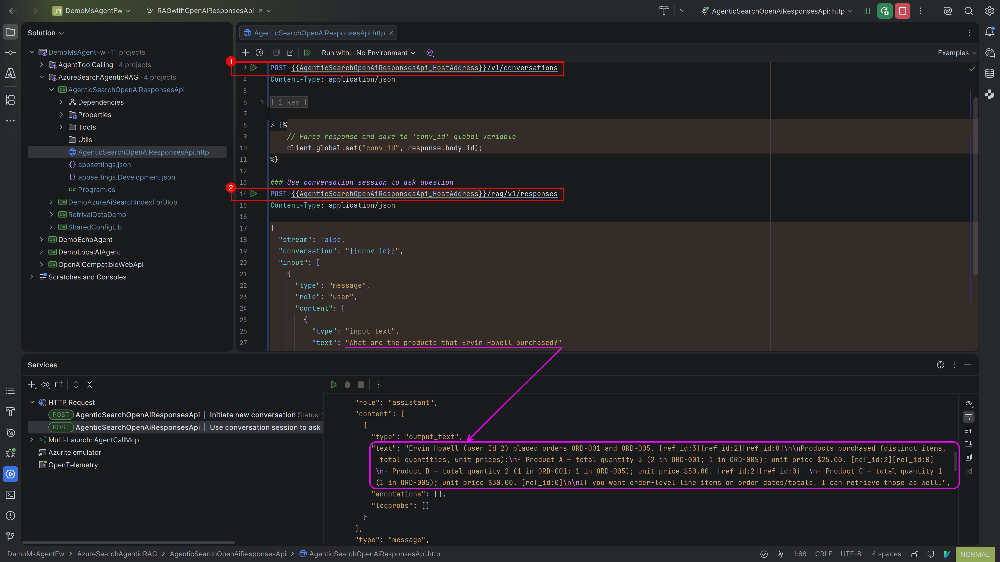

# Azure AI Search Agentic Retrieval (Agentic RAG) Demo

This project demonstrates how to use Azure AI Search "[Agentic Retrieval](https://learn.microsoft.com/en-us/azure/search/agentic-retrieval-overview)" to combine multiple sources of information to answer complex questions.

To run this project on local dev machine:
1. you need to install Azure CLI and login using `az login`
2. At least set following dotnet user-secrets:
    ```sh
    dotnet user-secrets set "AzureSearch:SearchEndPoint" "https://<YOUR-SEARCH-SERVICE>.search.windows.net"
    dotnet user-secrets set "AzureOpenAI:Endpoint" "https://<your-endpoint>.openai.azure.com"
    dotnet user-secrets set "AZURE_TENANT_ID" "<your-login-azure-tenant-id>"
    ```
3. Run `dotnet run` or use Visual Studio / JetBrains Rider IDE feature to start this web API project.
4. The use the `AgenticSearchOpenAiResponsesApi.http` file to interact with the Responses API.  
   
