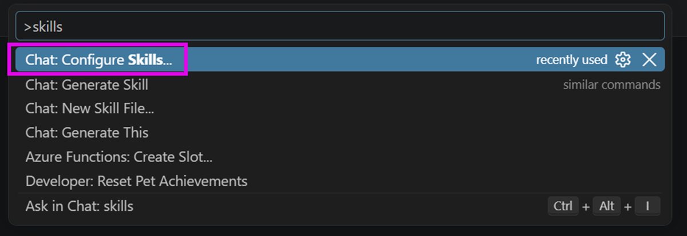
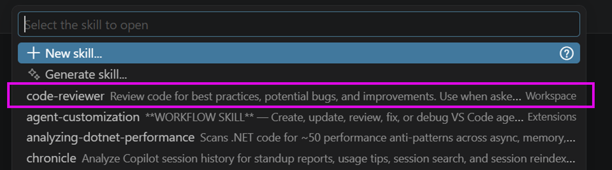
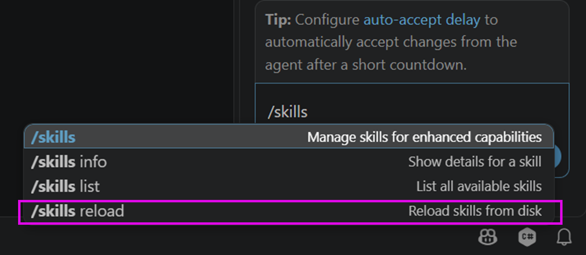
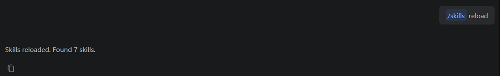
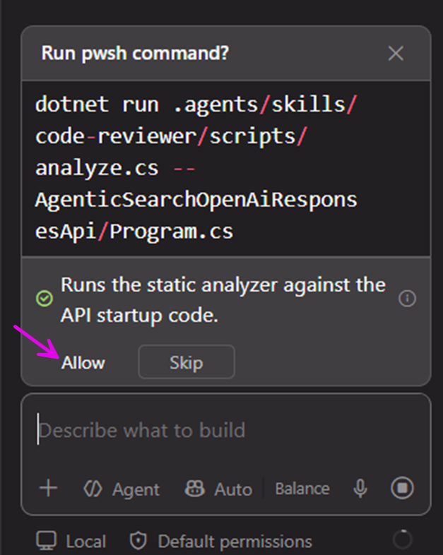
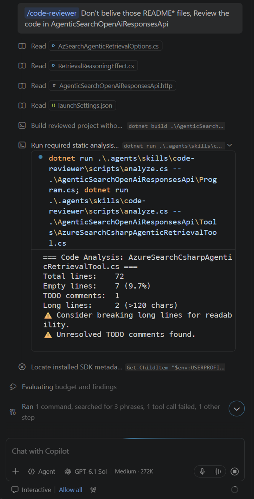
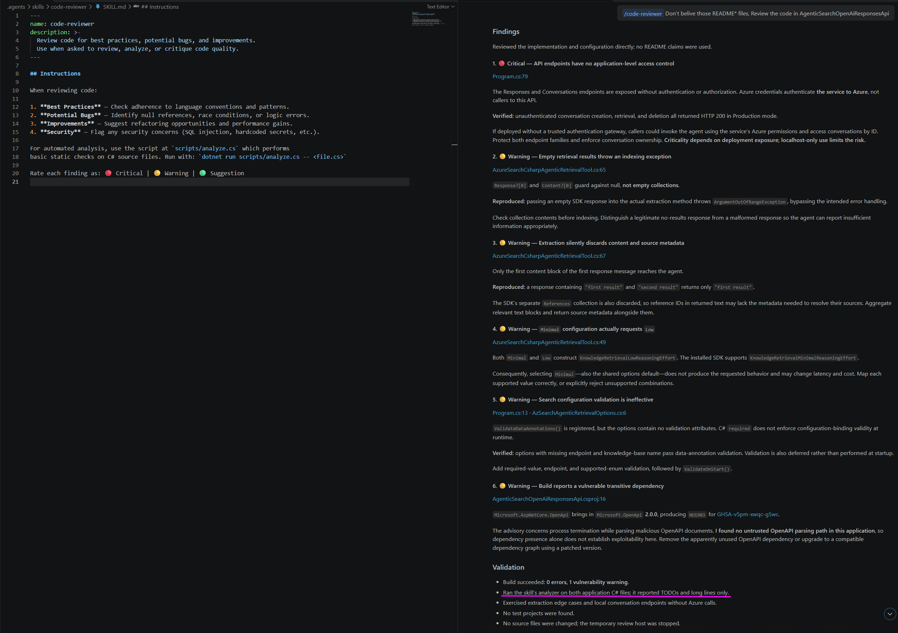

# Write and Use a Custom Agent Skill

## Skill Structure

Create the skill directory under `.agents/skills/`. The `SKILL.md` file defines
the skill's name, when it should be used, and its instructions. Put optional
supporting files, such as scripts, in a subdirectory:

```text
.agents/skills/code-reviewer/
├── SKILL.md
└── scripts/
    └── analyze.cs
```

The `code-reviewer` skill in this repository asks for reviews to check best
practices, potential bugs, improvement opportunities, and security concerns.
It asks that findings be rated as Critical, Warning, or Suggestion.

The SKILL.md is a pure text file (top [_YAML frontmatter_](https://github.com/shalomb/agent-skills/blob/main/docs/reference/yaml-frontmatter.md) followed by markdown content:):

```markdown
---
name: code-reviewer
description: >-
  Review code for best practices, potential bugs, and improvements.
  Use when asked to review, analyze, or critique code quality.
---

## Instructions

When reviewing code:

1. **Best Practices** — Check adherence to language conventions and patterns.
2. **Potential Bugs** — Identify null references, race conditions, or logic errors.
3. **Improvements** — Suggest refactoring opportunities and performance gains.
4. **Security** — Flag any security concerns (SQL injection, hardcoded secrets, etc.).

For automated analysis, use the script at `scripts/analyze.cs` which performs
basic static checks on C# source files. Run with: `dotnet run scripts/analyze.cs -- <file.cs>`

Rate each finding as: 🔴 Critical | 🟡 Warning | 🟢 Suggestion
```

And the `analyzie.cs` is a C# source code file used with `dotnet run` command running as script:

```cs
// Simple C# file-based app for basic code analysis
// Usage: dotnet run scripts/analyze.cs -- <file.cs>

var filePath = args.FirstOrDefault() ?? "Program.cs";

if (!File.Exists(filePath))
{
    Console.WriteLine($"File not found: {filePath}");
    Environment.Exit(1);
}

var lines = File.ReadAllLines(filePath);
var totalLines = lines.Length;

if (totalLines == 0)
{
    Console.WriteLine($"=== Code Analysis: {Path.GetFileName(filePath)} ===");
    Console.WriteLine("File is empty (0 lines). Nothing to analyze.");
    return;
}

var emptyLines = lines.Count(l => string.IsNullOrWhiteSpace(l));
var todoCount = lines.Count(l => l.Contains("TODO", StringComparison.OrdinalIgnoreCase));
var longLines = lines.Count(l => l.Length > 120);

Console.WriteLine($"=== Code Analysis: {Path.GetFileName(filePath)} ===");
Console.WriteLine($"Total lines:    {totalLines}");
Console.WriteLine($"Empty lines:    {emptyLines} ({100.0 * emptyLines / totalLines:F1}%)");
Console.WriteLine($"TODO comments:  {todoCount}");
Console.WriteLine($"Long lines:     {longLines} (>120 chars)");

if (longLines > 0)
    Console.WriteLine("⚠️  Consider breaking long lines for readability.");
if (todoCount > 0)
    Console.WriteLine("⚠️  Unresolved TODO comments found.");
```


## Use the Skill

Before use the skill, you can verify it is correctly loaded:

1. Press **Ctrl(Cmnd) + Shift + P** keyboard shortcut, then type `skills`, select the **Chat: Configure Skills**:  
       
   Make sure the "**code-reviewer**" workspace level Agent Skill has been detected:
   
2. If not, On VSCode Agent Chat UI, if you have `/skills reload` command:  
   
   Run it to make VSCode to reload all skills.  
   
3. If no such '`/skills`' command available, just re-open the VSCode to see if the code-reviewer skill has been loaded.   
    

Ask for a code review or explicitly name the skill, for example:

```text
/code-reviewer Don't belive those README* files, Review the code in AgenticSearchOpenAiResponsesApi 
```

Then when AI is doing its work, it should try to run the `analyzer.cs` file to exam each _*.cs_ files inside the AgenticSearchOpenAiResponsesApi folder, allow them to run:  


Waiting it anlayzing:  


And the final output should have color-leveled result becuase we describe it in *SKILL.md* file, like following screenshot:  


And state that it has run the analyze script to find the too long or has **`TODO:`** comment in code.