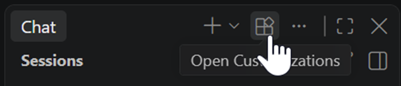
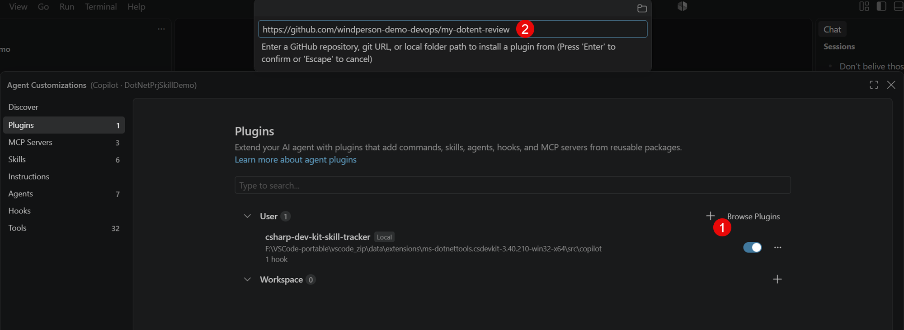
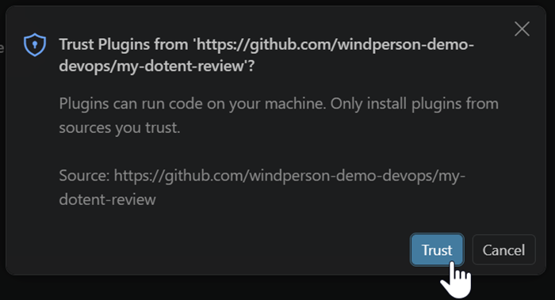
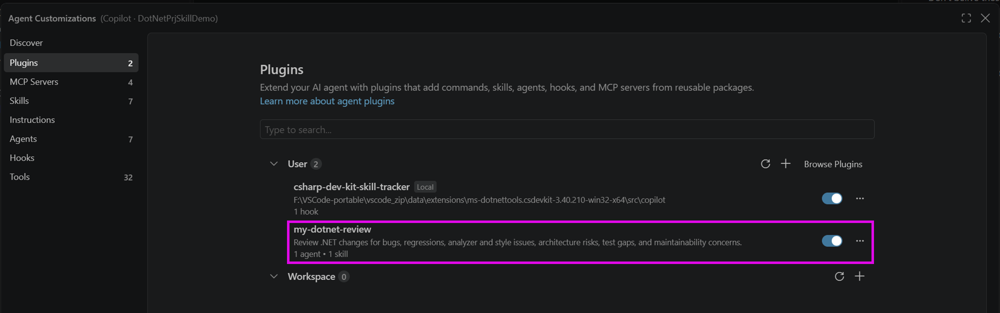
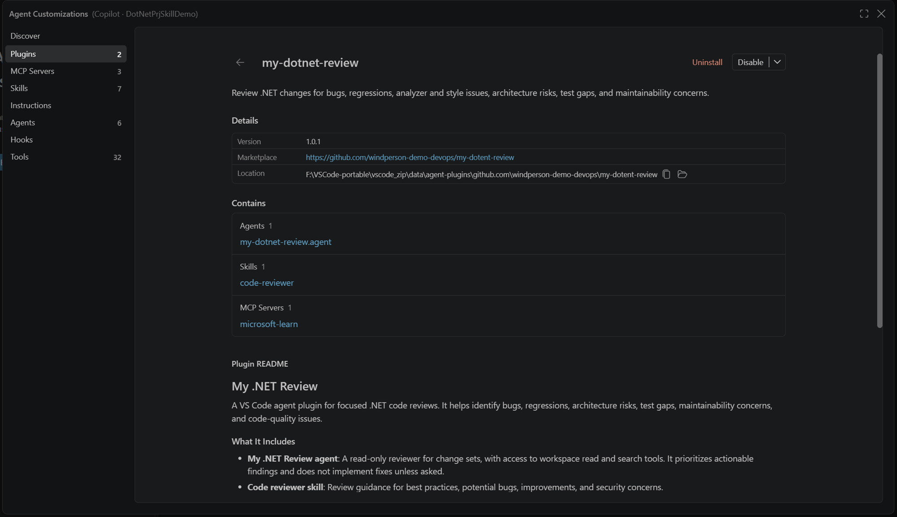
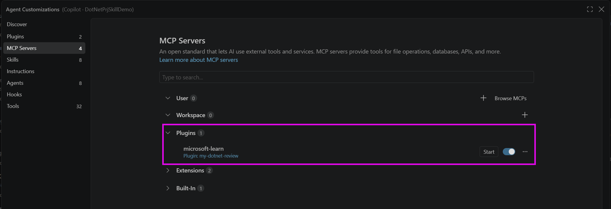
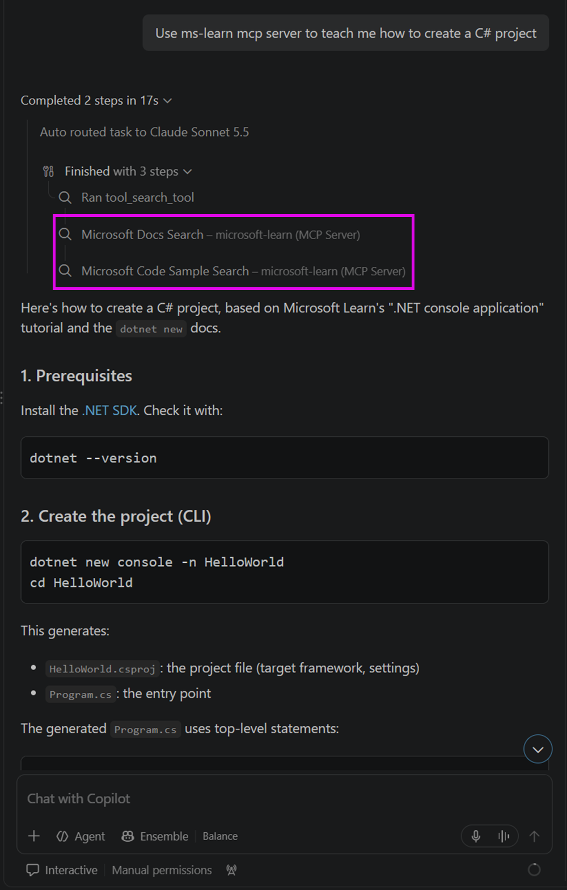
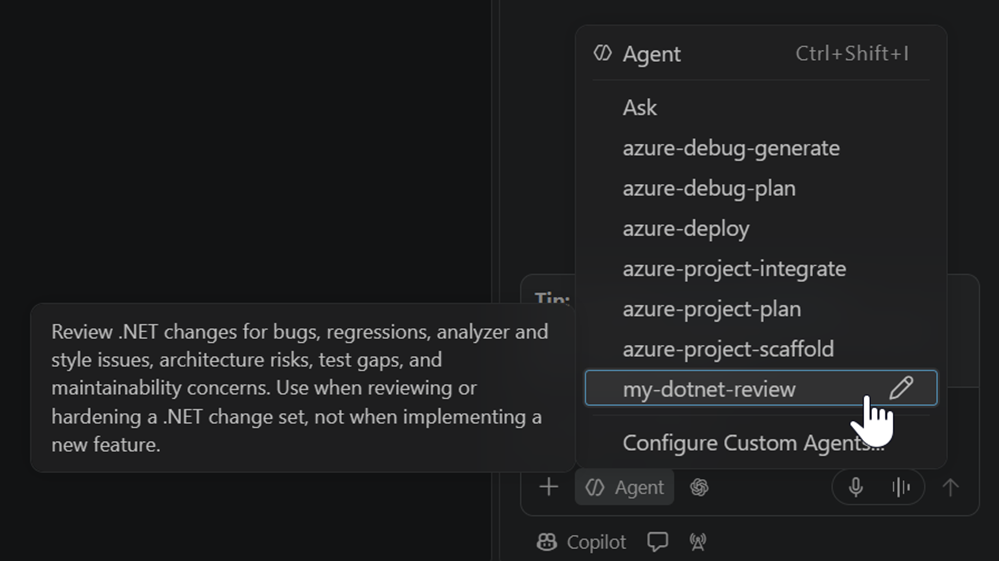
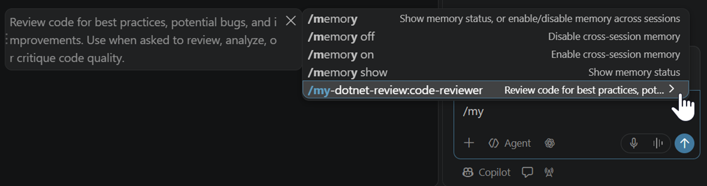
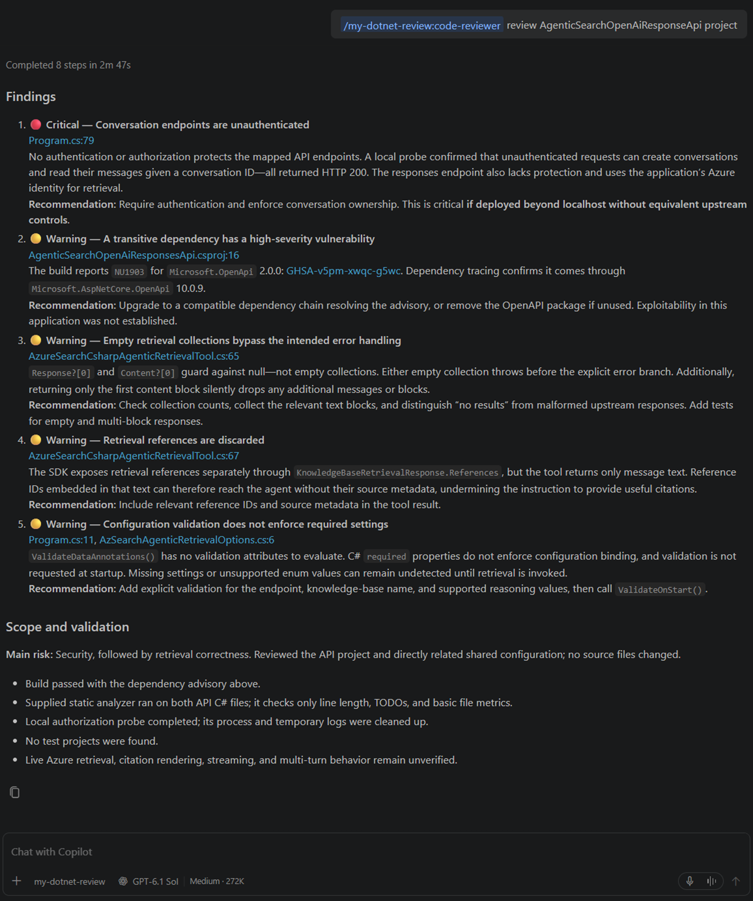

# Use Custom Agent Plugin in VSCode

In this practice we use a custom Agent Plugin [my-dotnet-review](https://github.com/windperson-demo-devops/my-dotent-review) that combine both Custom Agent and Agent Skill to do AI Code Review:

## Install Custom Agent Plugin in VSCode

1. Checkout or downlaod this git repository's [**origin**](https://github.com/dotnet-mcp-lab/DotNetPrjSkillDemo/releases/tag/origin) git tag:
   ```sh
   git checkout tags/origin -b demo
   ```
2. Open Agent Customizations window by clicking the second left icon on VSCode Agent Chat UI top bar:  
     
3. Click the "+" on User, than type the git url: **** on top pop-up:  
     
4. Then press Enter, click YES on pop-up confirm dialog:  
     
5. Custom Agent plugin will be installed:  
   
   And you can click it to see the deteail information that is from README.md of git repo.
   

Then we can close the Agent Customizations window and return to VSCode main UI to work woth it.

## Use services (MCP Server, Custom Agent, Agent Skill) provided in Custom Agent Plugin

The Custom Agent plugin will have the MS Learn MCP server installed:  


So we can use it during Agent session:



The **my-dotnet-review** custom agent should  


The **/my-dotnet-review:code-reviewer** Agent Skill can also be used:  


So we can use those two togehter like this:
```sh
/my-dotnet-review:code-reviewer review AgenticSearchOpenAiResponseApi project
```


---

