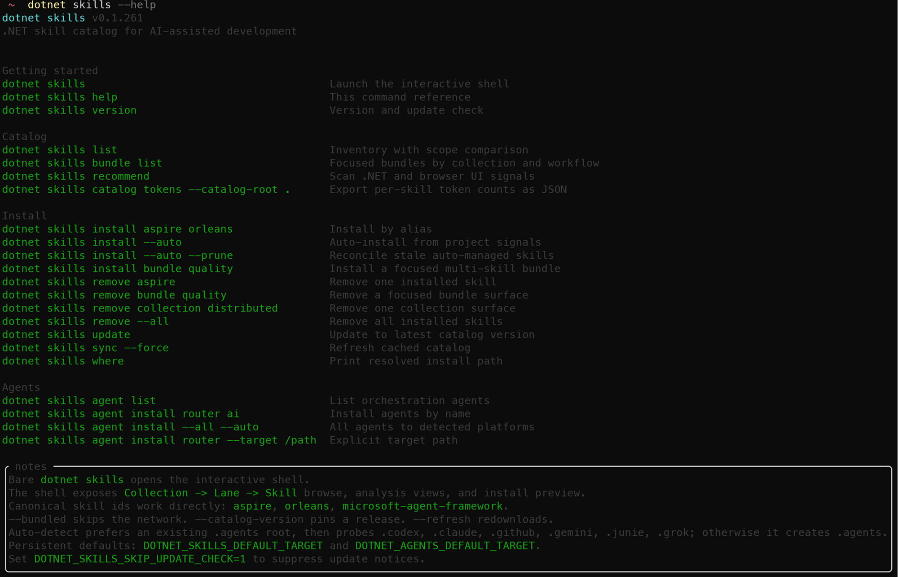
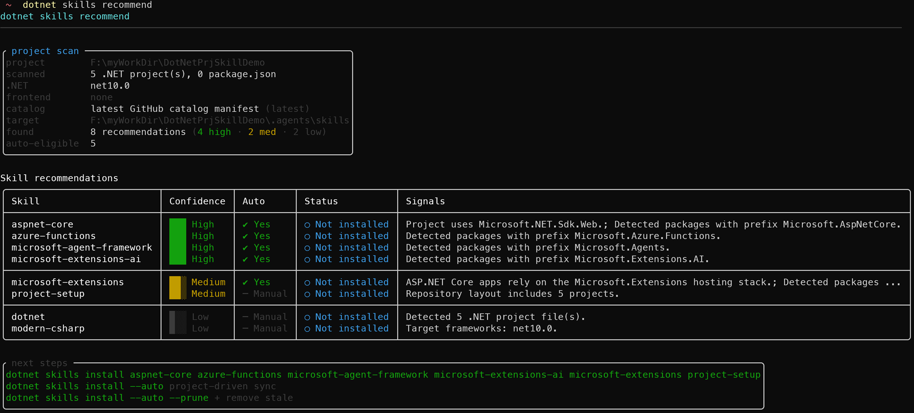
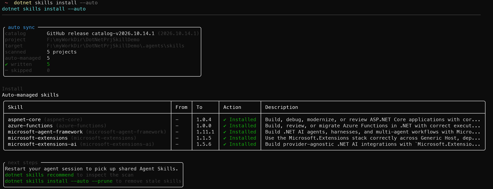
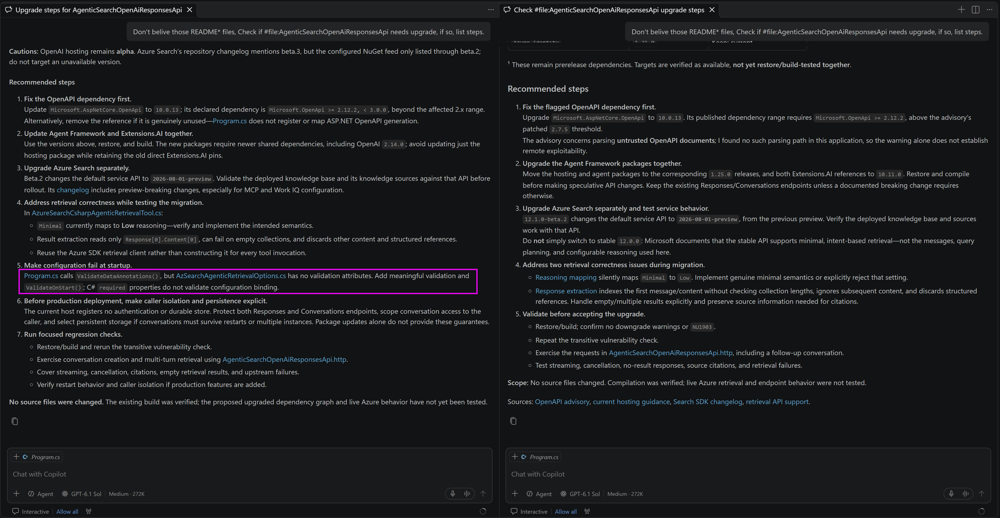

# Use dotnet-skills .NET Global tool to install Agent Skill

This is a practice to use a MIT-Licensed open source .NET Global tool [**dotnet-skills**](https://github.com/managedcode/dotnet-skills) to manage (recommend/install/uninstall)

## Install **dotnet-skills** .NET Global tool

Use this command line to install:

```sh
dotnet tool install --global dotnet-skills
```

Then you should have the sub-command: `dotnet skills ......` to access Agent Skills, for example, you can use _--help_ to list all support dotnet-skills sub commend

```sh
dotnet skills --help
```




## Get recommend Agent Skills for project

Use **recommend** sub comand, the dotnet-skills can help you identify what kinds of .net project is and provide recommend Agent Skill names:

```sh
dotnet skills recommend
```



So we know we should have [**_aspnet-core_**](https://github.com/managedcode/dotnet-skills/blob/main/catalog/Frameworks/ASP.NET-Core/skills/aspnet-core/SKILL.md), [**_azure_functions_**](https://github.com/managedcode/dotnet-skills/blob/main/catalog/Frameworks/Azure-Functions/skills/azure-functions/SKILL.md), [**_microsoft-agent-framework_**](https://github.com/managedcode/dotnet-skills/blob/main/catalog/Frameworks/Microsoft-Agent-Framework/skills/microsoft-agent-framework/SKILL.md), [**_microsoft-extensions-ai_**](https://github.com/managedcode/dotnet-skills/blob/main/catalog/Libraries/Microsoft-Extensions-AI/skills/microsoft-extensions-ai/SKILL.md) Agent Skills for easier AI coding development on this project.


## Install & Use nuget-package-manager Agent Skill

1. Before install any Agent Skills, try this prompt in VSCode Agent UI to see recommendation to improve current project:
   ```
   Don't belive those README* files, Check if #file:AgenticSearchOpenAiResponsesApi needs upgrade, if so, list steps.
   ```
   see what response it produce.
2. Install recommend Agent Skills via dotnet-skills:
   ```sh
   dotnet skills install --auto
   ``` 
   
3. And also install the [**NuGet Package Manager**](https://github.com/managedcode/dotnet-skills/blob/main/catalog/Tools/NuGetPackageManager/skills/nuget-package-manager/SKILL.md) skills:
   ```sh
   dotnet skills install nuget-package-manager
   ```
   This skill will use alternative ["Nuget Package Manager" .NET global tool](https://github.com/managedcode/NuGetPackageManager) to manage Nuget packages, you can install it beforehand:
   ```sh
   dotnet tool install --global nuget-manager
   ```
3. Try the prompt in Step 1 again, you should notice there's one more suggestion about validation of the option class, due to an addtional [Strongly-Typed Options with Validation](https://github.com/managedcode/dotnet-skills/blob/main/catalog/Frameworks/ASP.NET-Core/skills/aspnet-core/references/patterns.md#strongly-typed-options-with-validation) rule:
      
4. After finish this experiment, you can uninstall all previous installed Agent skills via:
   ```
   otnet skills remove --all
   ```