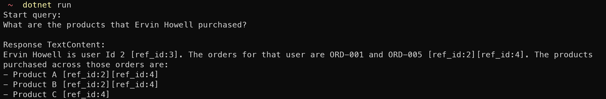
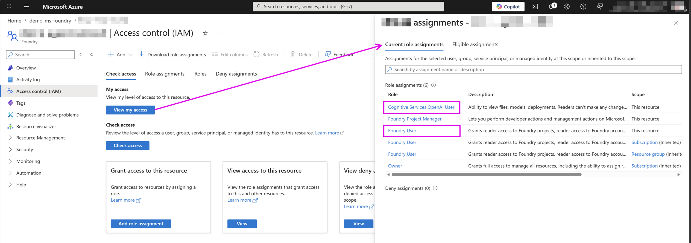
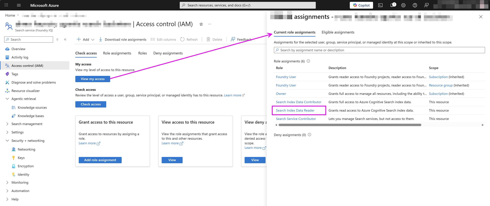
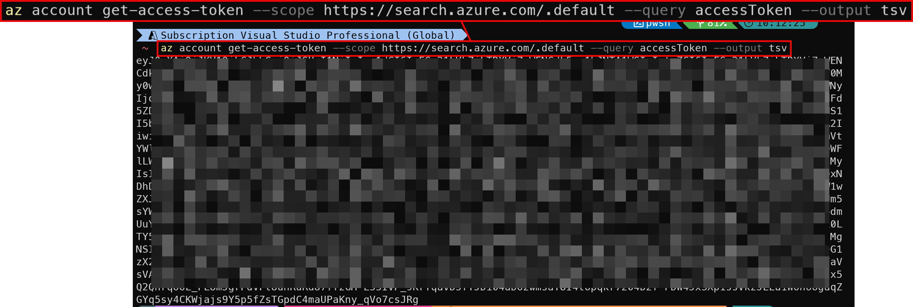
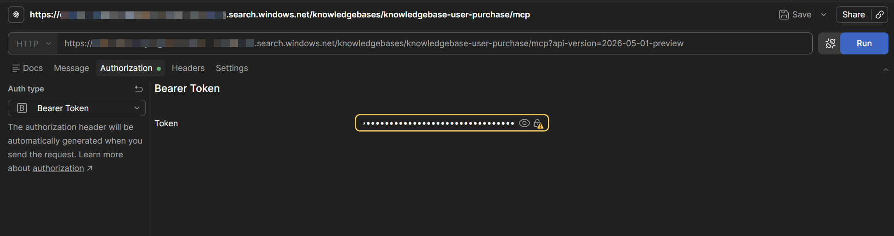
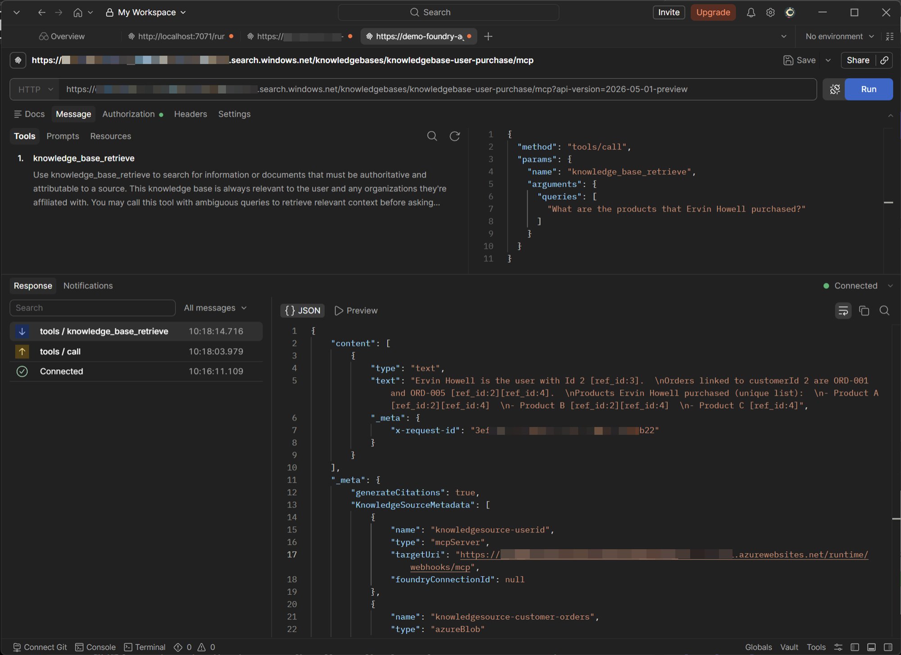

# Azure Agentic Retrieval C# API demo

This demo shows how to use the Azure Agentic Retrieval C# API to retrieve relevant information from a knowledge base.

To run this project:

1. Set User Secrets.
   ```sh
   dotnet user-secrets set "SearchServiceEndpoint" "https://<YOUR-SEARCH-SERVICE>.search.windows.net"
   dotnet user-secrets set "SearchServiceAdminKey" "knowledgebase-user-purchase"
   ```
2. Run `dotnet run` to start the application.



---

Or alternatively you can test Azure Agentic Retrieval [Knowledge Base as the MCP endpoint](https://learn.microsoft.com/en-us/azure/search/agentic-retrieval-how-to-retrieve?tabs=2026-05-01-preview&pivots=csharp#call-the-mcp-endpoint):

1. Install [Postman](https://www.postman.com/downloads/) and [Azure CLI](https://learn.microsoft.com/cli/azure/install-azure-cli).
2. Sign in Azure subscription using Azure CLI. (`az login`)
3. Make sure you have a valid Microsoft Foundry permissions: [**Foundry User**](https://learn.microsoft.com/en-us/azure/foundry/concepts/rbac-foundry?tabs=owner#built-in-roles) & [**Congnitive Services OpenAI User**](https://learn.microsoft.com/en-us/azure/foundry-classic/openai/how-to/role-based-access-control#cognitive-services-openai-user)  
   
4. Make sure you have a valid Azure AI services permissions: [**Search Index Data Reader**](https://learn.microsoft.com/en-us/azure/role-based-access-control/built-in-roles#search-index-data-reader)  
   
5. Get the [Bearer token via Azure CLI](https://learn.microsoft.com/en-us/azure/search/search-get-started-rbac?pivots=rest#get-token):
   ```sh
   az account get-access-token --scope https://search.azure.com/.default --query accessToken --output tsv
   ```
     
6. Copy the token string in previous step and use in Postman Auth:  
   
7. Use Postman to call Azure Agentic Retrieval Knowledge Base as a MCP endpoint:  
   